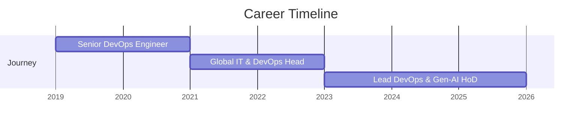

Hi, I'm **Chetan Soni** — Lead DevOps Engineer and Cloud Platform Specialist based in Bhopal, India.

I specialize in designing resilient multi-cloud architectures, orchestrating production Kubernetes clusters, automating zero-trust security postures, and optimizing continuous delivery pipelines with GitOps.

---

## 🚀 Professional Overview

```yaml
name: Chetan Soni
location: Bhopal, India
role: Lead DevOps Engineer | Cloud Platform Specialist
focus_areas:
  - Multi-Cloud Architecture (AWS, Azure, GCP)
  - Kubernetes Orchestration (EKS, GKE, AKS)
  - Infrastructure as Code (Terraform, Pulumi, Ansible)
  - GitOps & Continuous Delivery (ArgoCD, Flux, GitHub Actions)
  - DevSecOps & Zero-Trust Infrastructure
  - Generative AI Applications in DevOps
currently_learning: Advanced Kubernetes Operators, eBPF, Platform Engineering
open_to: DevOps Consulting, Cloud Architecture Advisory, Technical Collaboration
```

---

## 💼 Professional Experience



### 1. Lead DevOps & Gen-AI HoD (2023 – Present)
- Architected enterprise cloud infrastructure solutions across AWS, Azure, and Google Cloud Platform.
- Spearheaded Kubernetes cluster design (EKS, GKE, AKS) delivering high availability for production microservices.
- Implemented GitOps workflows with ArgoCD and Flux for zero-downtime continuous delivery.
- Designed zero-trust infrastructure security models and explored Gen-AI enhancements for DevOps workflows.

### 2. Global IT & DevOps Head (2021 – 2023)
- Built multi-stage CI/CD pipelines across Azure Pipelines, GitHub Actions, and GitLab CI.
- Managed container orchestration, service mesh configurations, and observability stacks.
- Standardized metrics and distributed logging using Prometheus, Grafana, and the ELK Stack.
- Reduced end-to-end deployment cycle times by 70% through automation.

### 3. Senior DevOps Engineer (2019 – 2021)
- Led migrations from legacy hosting to containerized cloud-native platforms.
- Provisioned repeatable Infrastructure as Code using Terraform and CloudFormation.
- Built automated test validation stages and maintained 99.9% production service uptime.

---

## 🏆 Certifications

- **AWS Certified Solutions Architect – Associate** (Amazon Web Services)
- **CKA – Certified Kubernetes Administrator** (Cloud Native Computing Foundation / Linux Foundation)
- **HashiCorp Certified: Terraform Associate** (HashiCorp)
- **Microsoft Certified: Azure Solutions Architect** (Microsoft)

---

## 🛠️ Technical Capabilities

| Domain | Technologies & Frameworks |
|---|---|
| **Cloud Providers** | AWS (EKS, ECS, VPC, IAM, S3, RDS), Azure, Google Cloud (GKE), DigitalOcean |
| **Containers & Orchestration** | Kubernetes, Docker, Helm, Podman, Istio Service Mesh |
| **Infrastructure as Code** | Terraform, AWS CloudFormation, Pulumi, Ansible, Packer |
| **CI/CD & GitOps** | GitHub Actions, Azure Pipelines, GitLab CI, ArgoCD, FluxCD |
| **Observability & Reliability** | Prometheus, Grafana, OpenTelemetry, ELK Stack, Datadog, New Relic |
| **Languages & Scripting** | Python, Bash, Go, JavaScript, YAML, JSON |

---

## 📄 Resume & Direct Contact

- 📥 **Download Resume**: [CHETAN SONI Resume DevOps (PDF)](/resume/CHETAN%20SONI%20Resume%20DevOps.pdf)
- 📅 **Schedule a Meeting**: [Book a time slot on Google Calendar](https://calendar.app.google/umYxcjewLfQ1PRwJ9)
- 💼 **LinkedIn**: [linkedin.com/in/sonichetan](https://www.linkedin.com/in/sonichetan/)
- 🐙 **GitHub**: [github.com/ErChetanSoni](https://github.com/ErChetanSoni)
- 📧 **Email**: [ErChetanSoni@gmail.com](mailto:ErChetanSoni@gmail.com)
- 💬 **WhatsApp**: [Chat directly via WhatsApp](https://wa.me/+919770325511)
