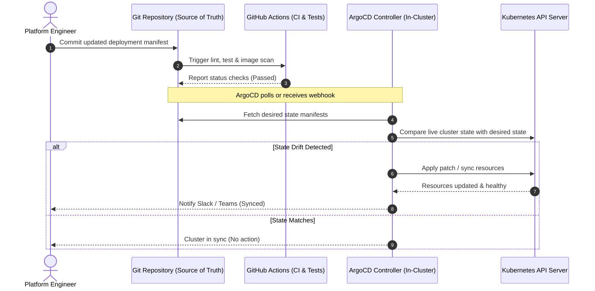

GitOps treats Git repositories as the sole source of truth for declared infrastructure and application state. By deploying an in-cluster agent like ArgoCD, teams eliminate manual `kubectl apply` commands, guarantee auditability, and automatically remediate configuration drift.

## Table of contents

## GitOps Lifecycle Workflow

The continuous delivery sequence illustrates how a Git commit triggers automated reconciliation without granting continuous deployment pipelines direct ingress access into the cluster:



## Declarative ArgoCD Application Manifest

Here is a production-grade ArgoCD `Application` Custom Resource Definition that targets an automated sync policy with automated pruning and self-healing:

```yaml
apiVersion: argoproj.io/v1alpha1
kind: Application
metadata:
  name: microservices-production
  namespace: argocd
  finalizers:
    - resources-finalizer.argocd.argoproj.io
spec:
  project: default
  source:
    repoURL: https://github.com/ErChetanSoni/production-manifests.git
    targetRevision: HEAD
    path: environments/production
  destination:
    server: https://kubernetes.default.svc
    namespace: production
  syncPolicy:
    automated:
      prune: true
      selfHeal: true
      allowEmpty: false
    syncOptions:
      - CreateNamespace=true
      - PruneLast=true
      - ApplyOutOfSyncOnly=true
    retry:
      limit: 5
      backoff:
        duration: 5s
        factor: 2
        maxDuration: 3m
```

## CLI Verification and Drift Inspection

Engineers can interact with the ArgoCD control plane directly via the CLI:

```bash
# Log in to the ArgoCD server instance
argocd login cd.internal.infra:443 --sso

# Inspect current application health and synchronization status
argocd app get microservices-production

# Trigger manual synchronization if automated sync is paused
argocd app sync microservices-production --prune

# Review resource diff between Git and live cluster
argocd app diff microservices-production
```

## Summary of Benefits

- **Zero Direct Cluster Access:** CI runners no longer require administrative cluster credentials.
- **Instant Rollbacks:** Reverting a release is as fast and clean as `git revert <commit-sha>`.
- **Automated Drift Remediation:** If someone modifies a live resource manually, ArgoCD promptly restores the Git-defined truth.
