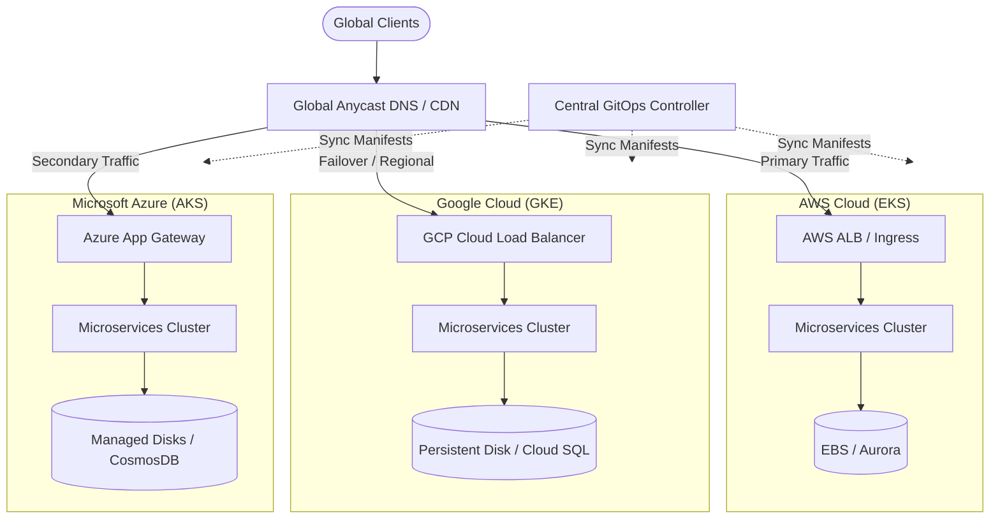

Operating mission-critical services across multiple cloud providers requires decoupling application logic from proprietary managed services. By utilizing standard Kubernetes APIs across AWS (EKS), Google Cloud (GKE), and Microsoft Azure (AKS), platform engineers can achieve true vendor neutrality and regional failover capabilities.

## Table of contents

## Multi-Cloud Architecture Overview

In a multi-cloud topography, global traffic distribution sits in front of cloud-specific ingress controllers. Each cloud cluster manages its own node autoscaling and storage classes while synchronizing application configuration via a centralized GitOps engine.



## Ingress and Service Discovery

Uniform traffic routing is achieved by pairing external DNS controllers with cloud-agnostic Helm charts. Here is an example manifest establishing an ingress resource configured for portable TLS termination:

```yaml
apiVersion: networking.k8s.io/v1
kind: Ingress
metadata:
  name: core-api-ingress
  namespace: production
  annotations:
    cert-manager.io/cluster-issuer: "letsencrypt-prod"
    kubernetes.io/ingress.class: "nginx"
spec:
  tls:
    - hosts:
        - api.erchetansoni.github.io
      secretName: core-api-tls
  rules:
    - host: api.erchetansoni.github.io
      http:
        paths:
          - path: /
            pathType: Prefix
            backend:
              service:
                name: core-api-svc
                port:
                  number: 8080
```

## Automated Cluster Health Verification

Platform teams should automate synthetic health probes across all regions. The following Bash snippet demonstrates probing health endpoints across cloud regions:

```bash
#!/usr/bin/env bash
set -euo pipefail

REGIONS=("aws-us-east-1" "gcp-us-central1" "azure-eastus")

for REGION in "${REGIONS[@]}"; do
  echo "Checking health for region: ${REGION}..."
  STATUS_CODE=$(curl -s -o /dev/null -w "%{http_code}" "https://${REGION}.api.internal/healthz")
  if [[ "${STATUS_CODE}" -ne 200 ]]; then
    echo "CRITICAL: Region ${REGION} returned status ${STATUS_CODE}" >&2
    exit 1
  fi
  echo "Region ${REGION} is healthy (HTTP 200)."
done
```

## Key Architectural Takeaways

1. **Decouple Data and State:** Maintain state synchronization using distributed databases (e.g. CockroachDB or Valkey clusters) or asynchronous event replication.
2. **Immutable Infrastructure:** Enforce cluster provisioning exclusively through Terraform modules and GitOps pipelines.
3. **Observability Mesh:** Aggregate Prometheus metrics and OpenTelemetry traces across all clouds into a unified Grafana workspace.
