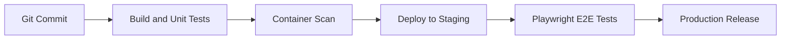

Technical documentation often incorporates visual architecture diagrams alongside source code. This article validates that valid Mermaid diagrams render as crisp SVG charts while invalid diagrams fail gracefully without breaking page rendering or build pipelines.

## Table of contents

## Section 1: Valid Mermaid Diagram

The diagram below tests valid flowchart syntax representing a continuous delivery health gate:



When rendered by the client-side parser, this block becomes an interactive SVG element styled to match the active color scheme.

## Section 2: Deliberately Malformed Diagram Syntax

The block below contains deliberately invalid Mermaid syntax to verify resilient error boundary handling:

```mermaid
graph INVALID_DIRECTION_???
    A >>>>> B ----> ???
    [Broken Node Bracket
    --- syntax error intentional ---
```

### Expected Resilient Behavior

Rather than causing an unhandled JavaScript exception or breaking the page layout:
1. The error boundary catches the parsing failure.
2. The UI displays an informative notice explaining that the diagram syntax could not be parsed.
3. The raw fenced code is safely preserved for reader reference.
4. The remaining content of the page continues to function perfectly.
